 

**Aevora j.d.o.o.** is a software company from Croatia. We build AI automation, process optimization, custom software and integrations, and the Scan & Go app.

Queues at the till. Invoices typed in twice. Spreadsheets passed around by email. All of it is work a computer could do. We find that work and build the software that does it.

 

## What we do

| Service | What it does |
|:--|:--|
| **AI automation of business processes** | Software that reads, sorts and enters the routine work for you. |
| **Process and cost optimization** | We map how work really flows, find the waste and fix it with data. |
| **Custom software and apps** | Web and mobile apps built around one business and the way it works. Mobile in Flutter for iOS and Android. |
| **Integrations and infrastructure** | Your tools connected, on infrastructure that stays up. |

Most projects combine two or three of these. [More on the services →](https://aevora.hr/services)

 

## Scan & Go

**Scan. Pay. Walk out.** A scan-and-pay app for shops: customers scan products with their phone, pay in the app and leave. One app works in every shop that uses it, launching in Croatia first.

| | Step | What happens |
|:--|:--|:--|
| `01` | **Walk in** | Scan the QR code at the entrance. The app recognises the store and starts the trip. |
| `02` | **Scan as you shop** | Each product is scanned with the phone as it goes into the basket. |
| `03` | **Pay in the app** | When the basket is complete, the customer pays on the phone. |
| `04` | **Walk out** | No till, no line, no waiting for a terminal. |

[How Scan & Go works →](https://aevora.hr/scan-and-go) &nbsp;·&nbsp; [Request a demo →](https://aevora.hr/scan-and-go#demo)

 

## How a project runs

`01` **Look first.** We start with how the work is done now, who does it and what it costs. Not with a tool. 
`02` **Build the smallest useful thing.** A first version that people use early, so the next decision is based on real use. 
`03` **Measure, then extend.** We keep what saves time, drop what does not and grow the system from there.

 

## Contact

Tell us what slows you down. A short message is enough.

| To | Where |
|:--|:--|
| Start a project | [aevora.hr/contact](https://aevora.hr/contact) |
| Email | [info@aevora.hr](mailto:info@aevora.hr) |
| Website | [aevora.hr](https://aevora.hr) &nbsp;·&nbsp; na hrvatskom: [aevora.hr/hr](https://aevora.hr/hr) |

 

Aevora j.d.o.o. · Croatia · Our repositories are private; this page is the public face of the account.
